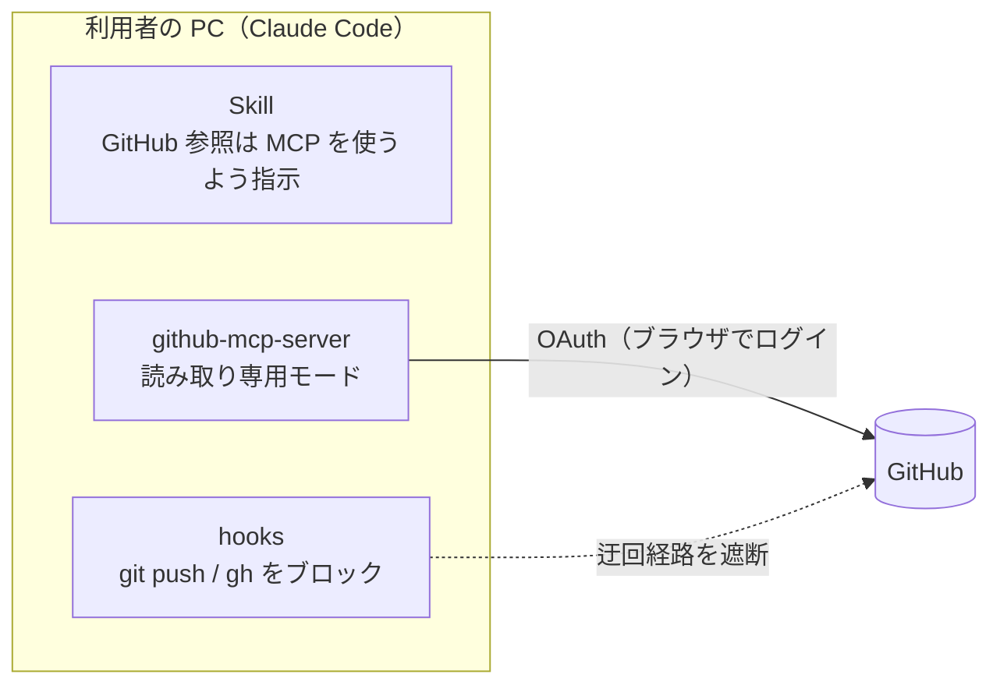
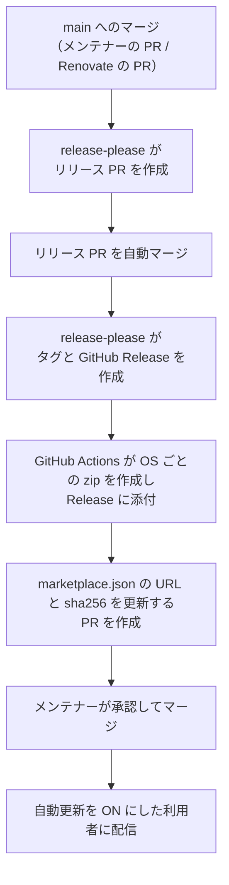

# GitHub Readonly MCP プラグイン 設計書

Claude Code から GitHub を参照できるようにするための、要件・設計方針・運用方針をまとめた文書です。
実装の詳細はリポジトリ内のコードを正とし、この文書には方針とその理由のみを記載します。

## 1. 背景と目的

非エンジニアのメンバーでも、Claude Code（Claude デスクトップアプリの Code タブ）を使って、GitHub リポジトリのコードを参照・質問できるようにしたい。
ただし、gitコマンドやghコマンドを使う方式だと、非エンジニアのメンバーが内容を理解しないままAIにコマンド実行許可を出してしまい、意図しないコード修正をpushしてしまうリスクがあるため、そのような事故を防ぐ仕組みを作る。

## 2. 要件

### 2.1 機能要件

| ID  | 要件                                                                                                                                               |
| --- | -------------------------------------------------------------------------------------------------------------------------------------------------- |
| F-1 | Claude Code から GitHub リポジトリのファイル内容、コミット、ブランチ、タグ、リリース、イシューを参照できる                                         |
| F-2 | Claude Code から GitHub への書き込み（push、ファイル作成・更新・削除、ブランチ作成、リポジトリ作成、フォーク、イシュー起票、コメント）ができない。 |
| F-3 | 非公開リポジトリ（組織のリポジトリを含む）を参照できる                                                                                             |

### 2.2 制約

| ID  | 制約                                                                              |
| --- | --------------------------------------------------------------------------------- |
| C-1 | 個人アクセストークン（PAT）を使わない                                             |
| C-2 | 利用者の PC に Docker は無い                                                      |
| C-3 | 利用者にターミナル操作をさせない（Claude アプリの入力欄へのコマンド貼り付けは可） |
| C-4 | 利用者のセットアップ手順はできるだけ単純にする                                    |
| C-5 | 利用者の OS は主に Windows、一部 Mac（Apple Silicon / Intel）                     |
| C-6 | 利用者への配布を容易にするため、パブリックリポジトリとしてMITライセンスで公開する |

## 3. 設計

### 3.1 全体像

| 構成要素                               | 役割                                                                                                    | 対応する要件 |
| -------------------------------------- | ------------------------------------------------------------------------------------------------------- | ------------ |
| github-mcp-server（GitHub 公式）       | GitHub の参照手段。読み取り専用モードで起動し、書き込み系ツールを提供しない                             | F-1, F-2, F-3 |
| Skill                                  | GitHub を参照するときは github-mcp-server のツールを使うよう Claude に指示する                           | F-1          |
| hooks                                  | github-mcp-server を迂回した書き込み（`git push`、`gh` コマンドなど）を実行前にブロックするガードレール | F-2          |

### 3.2 GitHub へのアクセス方式

| 観点           | 方針                                                                                                     | 理由                                                                                         |
| -------------- | -------------------------------------------------------------------------------------------------------- | -------------------------------------------------------------------------------------------- |
| 実行方式       | 公式配布の実行ファイルをプラグインに同梱し、ローカルで起動する（stdio）                                  | Docker が不要（C-2）。利用者による個別インストールも不要（C-3, C-4）                         |
| 認証           | 公式実行ファイルに組み込まれた OAuth ログインを使う。トークンはメモリ上にのみ保持される                  | PAT を使わない（C-1）。初回にブラウザでログインするだけで済む（C-4）                         |
| 書き込みの防止 | github-mcp-server の読み取り専用モード（`--read-only`）と hooks の二重で防ぐ                               | OAuth の `repo` スコープは読み書きが一体のため、トークンの権限では書き込みを制限できない     |
| 権限の最小化   | OAuth で要求するスコープを `repo` と `read:org` に絞り、使うツールセット（context、repos、issues、pull_requests）を明示する。公開リポジトリでは、push 権限のない人が書いたイシューやコメントを隠す（lockdown モード） | 漏えい時の影響を小さくするため。上流の既定値が変わっても使えるツールが勝手に増えないようにするため。イシューの本文などに AI 向けの指示を仕込む攻撃（プロンプトインジェクション）への対策 |

hooks は Claude Code の Bash ツールと PowerShell ツールの両方を対象にします。ただし、コマンドの書き方次第ではすり抜けられる「ガードレール」であり、完全な防御ではありません。主たる防御は github-mcp-server の読み取り専用モードです。

### 3.3 配布単位

利用者は自分の環境に合うプラグインを 1 つだけインストールします。

| プラグイン名                        | 対象                         | 利用者の見分け方                                   |
| ----------------------------------- | ---------------------------- | -------------------------------------------------- |
| `github-readonly-windows`           | Windows（x64）               | Windows であればこれ                               |
| `github-readonly-mac-apple-silicon` | Apple シリコン搭載の Mac     | 「この Mac について」に「チップ」と表示される      |
| `github-readonly-mac-intel`         | Intel プロセッサ搭載の Mac   | 「この Mac について」に「プロセッサ」と表示される  |

Windows（ARM）は対象外とします。

### 3.4 配布方式

| 観点               | 方針                                                                                                                         | 理由                                                                                                                       |
| ------------------ | ---------------------------------------------------------------------------------------------------------------------------- | -------------------------------------------------------------------------------------------------------------------------- |
| 実行ファイルの置き場 | リポジトリには含めず、OS ごとの zip としてこのリポジトリの GitHub Releases に置く                                              | マーケットプレイスの追加時はリポジトリ全体が利用者の PC に複製されるため、リポジトリに置くと全 OS 分が全員に配られてしまう |
| マーケットプレイス | 各プラグインの取得元に `archive`（zip の URL と sha256）を指定する                                                             | 利用者は自分の OS の zip だけをダウンロードする。sha256 で改ざんを検知できる                                              |
| 共通部分の管理     | Skill と hooks のルールは 1 か所で管理し、OS ごとの差分（実行ファイル、MCP サーバーの起動設定）はビルド時に組み立てる。hooks は全 OS 共通の設定にする | OS 間で同じ内容を重複して保守しない                                                                                      |
| 実行ファイルの検証 | ビルド時に、公式リリースのチェックサムとの照合に加え、ビルド来歴の証明（artifact attestation）を検証し、github-mcp-server の公式リリース用ワークフローがビルドしたものであることを確認してから同梱する | 改ざんされた実行ファイルの配布を防ぐ。チェックサムだけでは、同じ Release に置かれたチェックサム自体が改ざんされた場合に検知できないため |
| ライセンス         | 同梱する github-mcp-server と同じタグから、github-mcp-server 本体のライセンスと、同梱ライブラリのライセンス一式（上流の `third-party/` ディレクトリと OS 別の一覧）を zip に含める | github-mcp-server は MIT ライセンスで、同梱ライブラリにも MIT・BSD・Apache-2.0 などがある。再配布時には、それぞれの著作権表示とライセンス文（Apache-2.0 の NOTICE を含む）の同梱が必要 |

## 4. 運用

### 4.1 リリースの流れ

リリースの作成までは自動で行います。利用者への配信（marketplace.json の更新）だけは、メンテナーの承認を必須にします。

| 項目                 | 方針                                                                                                                                       |
| -------------------- | ------------------------------------------------------------------------------------------------------------------------------------------ |
| バージョン管理       | release-please で管理する。コミットメッセージは Conventional Commits 形式とし、`fix:` でパッチ、`feat:` でマイナーのバージョンを上げる   |
| リリース PR          | 常に自動マージする。変更内容のレビューは、main へマージする前の各 PR で行う                                                               |
| marketplace.json     | zip を公開した後に、更新用の PR を作る。公開前の zip を指す状態を作らないため。PR では zip の sha256 と中身を自動で検証する。未マージの古い PR は、新しい PR を作るときに自動で閉じる（後からマージして配信中のバージョンが巻き戻るのを防ぐため） |
| 配信の承認           | marketplace.json の変更はメンテナーの承認を必須にする。リポジトリへの書き込み権限を持つトークンが漏れても、利用者に届く zip を勝手に差し替えられないようにするため |

### 4.2 github-mcp-server の更新

| 項目               | 方針                                                                                                                                 |
| ------------------ | ------------------------------------------------------------------------------------------------------------------------------------ |
| 検知               | Renovate が公式リリースを監視し、同梱するバージョンを更新する PR を作る                                                              |
| 待機期間           | 公開から 3 日経ったバージョンだけを対象にする。公開直後の不具合修正リリースを待つため                                                |
| 自動チェック       | PR ごとに、新しい実行ファイルが読み取り専用モードで書き込み系ツールを 1 つも提供しないことを機械的に確認する                         |
| マージ             | マイナー・パッチの更新は、自動チェックが通れば自動マージする。メジャーの更新は、仕様変更の可能性があるためメンテナーが確認してマージする |
| リリース           | Renovate のコミットは `fix(deps):` 形式とし、4.1 の流れでパッチリリースされる。利用者への配信には 4.1 のとおりメンテナーの承認が必要 |

### 4.3 利用者への配信

マーケットプレイスの自動更新は初期状態で OFF のため、利用者のセットアップ手順の中で自動更新を ON にしてもらいます。ON にした利用者には、リリース後に Claude Code が自動で新しいバージョンを取り込みます。

### 4.4 メンテナーの対応が必要な場面

| 場面                                 | 対応                                                               |
| ------------------------------------ | ------------------------------------------------------------------ |
| リリースのたび                       | marketplace.json を更新する PR で、前回配信したタグとの差分（PR 本文のリンク）と自動検証の結果を確認し、承認してマージする |
| github-mcp-server のメジャー更新     | Renovate の PR を確認し、問題がなければマージする                  |
| 自動チェックやリリースの失敗         | GitHub の通知を受けて原因を調べ、修正する                          |
| Skill や hooks の変更                | 通常どおり PR を作成・レビューしてマージする（マージ後は自動でリリースされる） |

### 4.5 初期設定（メンテナーが 1 回だけ行う）

| 項目                       | 内容                                                                                                                                                         |
| -------------------------- | ------------------------------------------------------------------------------------------------------------------------------------------------------------ |
| リリース用 GitHub App      | GitHub Actions が標準で使うトークン（`GITHUB_TOKEN`）による操作では後続のワークフローが起動しないため、リリース PR の作成とマージには専用の GitHub App を使う。App には Contents・Pull requests・Issues の読み書き権限を与え、Client ID をリポジトリの Variables（`RELEASE_APP_CLIENT_ID`）に、秘密鍵を Secrets（`RELEASE_APP_PRIVATE_KEY`）に登録する |
| Renovate                   | Mend Renovate の GitHub App をこのリポジトリにインストールする                                                                                                |
| main ブランチの保護        | main にルールセットを設定し、PR 経由の変更だけを許可したうえで、Code Owners のレビューを必須にする。`.github/CODEOWNERS` で marketplace.json、ワークフロー、CODEOWNERS 自体のオーナーをメンテナーにしているため、これらを変更する PR だけがメンテナーの承認を必要とし、リリース PR と github-mcp-server を更新する Renovate の PR は自動マージのまま動く。PR の作成者は自分の PR を承認できないため、ルールセットはこれらのファイルを追加する PR をマージした後に有効にする |
| GitHub 組織での OAuth アプリの承認 | 組織の非公開リポジトリを参照する場合、組織のオーナーが、github-mcp-server の公式実行ファイルに組み込まれた OAuth アプリを承認する。承認すると組織のメンバーがこのアプリに `repo` スコープなどを渡せるようになるため、組織のセキュリティ担当と相談したうえで判断する。SAML SSO を使う組織では、メンバーごとにトークンの SSO 承認も必要 |
